# hackaton-sogr

Mis soluciones en Java para los retos de la hackatón: cinco problemas del Code Jam de Google y cinco retos sobre la API de Claude.

```
google/          problemas de Google
claude/          retos de Claude (Json.java es un parser de JSON que usan varios)
entradas/        entrada oficial de cada reto
docs/capturas/   resultado de cada programa en la terminal
```

Para correr uno:

```bash
javac -encoding UTF-8 -d out google/*.java claude/*.java
java -cp out google.ChainReactions < entradas/ChainReactions.txt
```

La entrada va con `<` y no pegada en la terminal, porque la terminal corta las líneas largas y el programa se queda esperando.

---

## Google

### D1000000

Escalera más larga 1, 2, ..., L usando cada dado una vez. Ordeno los dados y uso cada uno si tiene más caras que el largo actual.

[Código](google/D1000000.java) · [Entrada](entradas/D1000000.txt)

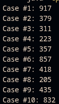

### Moons and Umbrellas

Reemplazar los `?` de un mural para pagar lo menos posible por cada CJ y JC. Programación dinámica guardando el costo mínimo si la cadena termina en C o en J.

[Código](google/MoonsAndUmbrellas.java) · [Entrada](entradas/MoonsAndUmbrellas.txt)

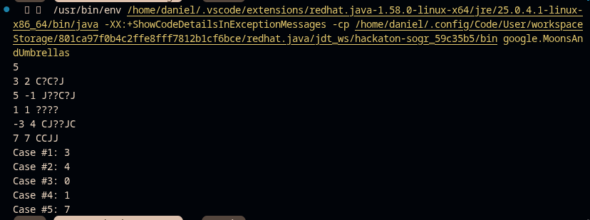
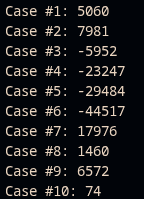

### Parenting Partnering Returns

Repartir actividades entre Cameron y Jamie sin que se crucen. Ordeno por hora de inicio y le doy cada actividad a quien esté libre; si ninguno lo está, es imposible.

[Código](google/ParentingPartneringReturns.java) · [Entrada](entradas/ParentingPartneringReturns.txt)

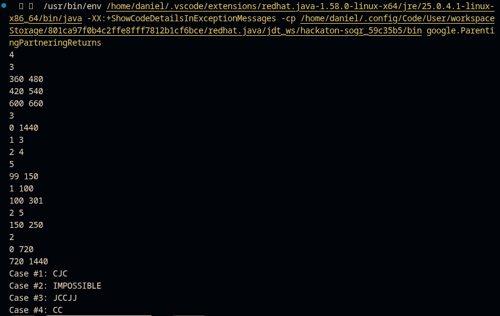
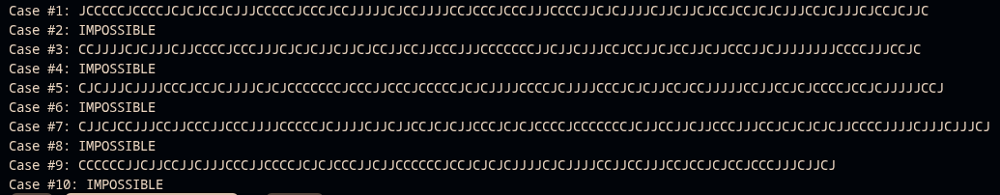

### Chain Reactions

Escoger el orden de los iniciadores para sumar la mayor diversión. Recorro el árbol de las hojas a la raíz y en cada nodo dejo seguir la cadena del hijo con menor valor.

[Código](google/ChainReactions.java) · [Entrada](entradas/ChainReactions.txt)

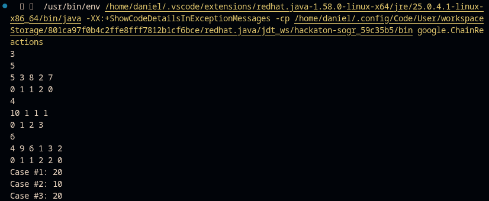
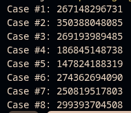

### Bathroom Stalls

Dónde queda la última de K personas en N cubículos, con N hasta 10^18. En vez de simular, agrupo los huecos libres por tamaño y los parto en bloque.

[Código](google/BathroomStalls.java) · [Entrada](entradas/BathroomStalls.txt)

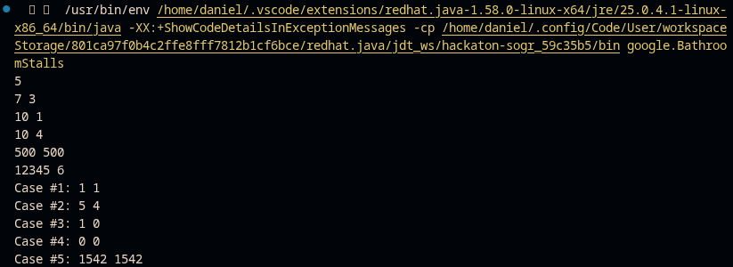
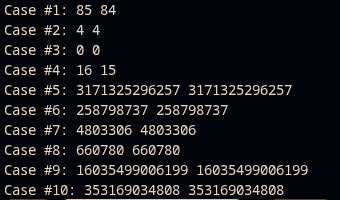

---

## Claude

### Respuesta en streaming

Reconstruir los mensajes que la API manda en pedazos: juntar los `text_delta` de cada bloque e imprimir el texto, el `stop_reason` y los tokens.

[Código](claude/RespuestaEnStreaming.java) · [Entrada](entradas/RespuestaEnStreaming.txt)

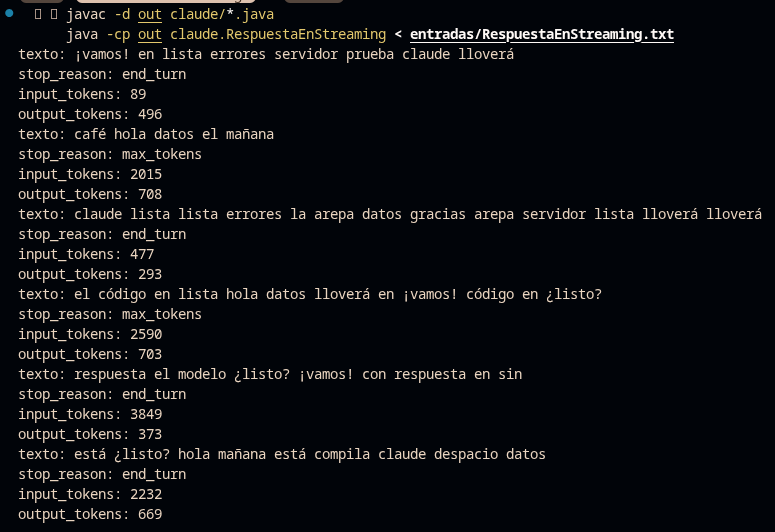

### Uso de herramientas

Ejecutar las herramientas que pide el modelo (calculadora y clima), devolver el error que corresponda cuando algo no existe y contar llamadas y errores.

[Código](claude/UsoDeHerramientas.java) · [Entrada](entradas/UsoDeHerramientas.txt)

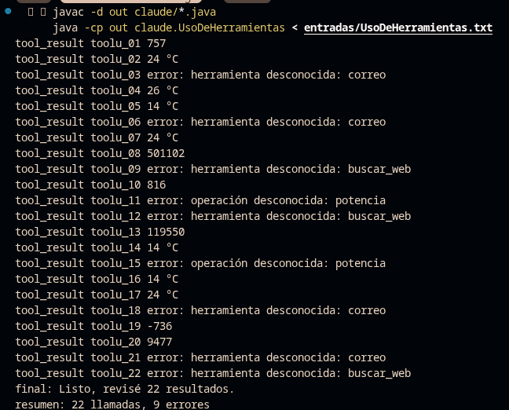

### Costos con caché de prompts

Calcular cuánto cuesta cada llamada y cuánto se ahorra con la caché. Uso enteros en vez de decimales para que el redondeo no falle.

[Código](claude/CostosConCacheDePrompts.java) · [Entrada](entradas/CostosConCacheDePrompts.txt)

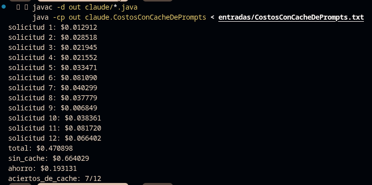

### Límites de velocidad

Simular el límite de solicitudes y tokens por minuto con dos cubetas que se recargan con el tiempo, y responder `ok` o `429 retry-after=N`.

[Código](claude/LímitesDeVelocidad.java) · [Entrada](entradas/LímitesDeVelocidad.txt)

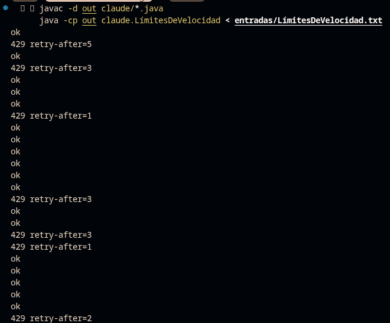

### Evaluación de respuestas

Revisar si cada respuesta del modelo contiene lo esperado como palabras completas, sin importar tildes ni mayúsculas, y dar el resultado por categoría.

[Código](claude/EvaluacionDeRespuestas.java) · [Entrada](entradas/EvaluacionDeRespuestas.txt)

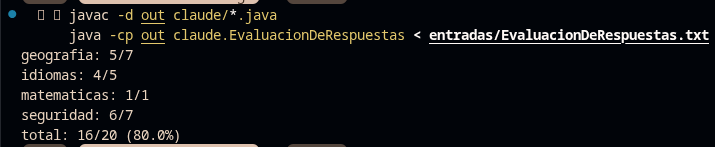
